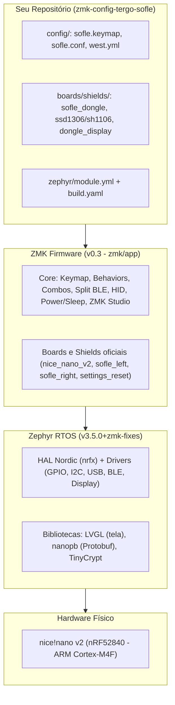
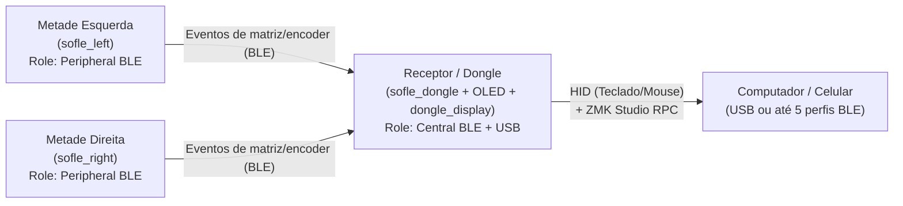

# 01 — Arquitetura do ZMK e Como Este Repositório Funciona

Antes de alterar o código-fonte do firmware, vale entender como todas as peças se encaixam: do silício da placa até o arquivo `.uf2` que você arrasta para o teclado.

---

## 1. As Camadas do Firmware

O **ZMK** não é um firmware "do zero" como o QMK antigo: ele é uma **aplicação construída em cima do Zephyr RTOS**, um sistema operacional de tempo real (RTOS) mantido pela Linux Foundation.



---

## 2. Arquitetura do Teclado Dividido com Dongle Central

No Tergo Sofle sem fio existem **três microcontroladores** `nice_nano_v2` independentes:



- **Metade Esquerda (`sofle_esquerdo`)** e **Metade Direita (`sofle_direito`)**:
  - Compiladas com `-DCONFIG_ZMK_SPLIT=y -DCONFIG_ZMK_SPLIT_ROLE_CENTRAL=n`.
  - São **periféricos**: apenas escaneiam a matriz de teclas e os encoders (`EC11`) e enviam as posições pressionadas via BLE para o dongle.
  - Por isso têm firmware bem menor (~348 KB `.uf2`) e consomem muito pouca bateria.
- **Receptor / Dongle (`sofle_receptor_*`)**:
  - É o **cérebro (Central)**: recebe os eventos das duas metades (`CONFIG_ZMK_SPLIT_BLE_CENTRAL_PERIPHERALS=2`), processa o `config/sofle.keymap` (camadas, hold-tap, combos, mouse), controla o display OLED (`dongle_display` via LVGL), gerencia até 5 perfis Bluetooth + USB (`CONFIG_BT_MAX_CONN=7`, sendo 2 periféricos + 5 hosts) e expõe o **ZMK Studio** (`studio-rpc-usb-uart`).
  - Por isso, quase toda mudança de comportamento, keymap ou lógica central exige regravar **apenas o dongle** (a menos que você altere drivers de scan, bateria, sleep ou protocolo split nas metades).

---

## 3. Os Conceitos-Chave do Ecossistema Zephyr / ZMK

### West (Meta-ferramenta)
O `west` é a ferramenta de linha de comando do Zephyr que faz dois papéis:
1. **Gerenciador multi-repositório**: lê um arquivo de manifesto (`west.yml`) e baixa automaticamente todas as dependências nas revisões exatas (`zmk`, `zephyr`, `hal_nordic`, `lvgl`, `nanopb`, `zmk-studio-messages`, etc.).
2. **Orquestrador de build**: o comando `west build` invoca o CMake e o Ninja com as variáveis certas do Zephyr.

### Kconfig (`.conf`, `Kconfig.defconfig`, `Kconfig.shield`)
Sistema de opções booleanas, numéricas e strings (`CONFIG_*`) que decide **quais módulos de código C são compilados** e com quais parâmetros. Exemplos neste repo:
- `config/sofle.conf`: ativa `CONFIG_ZMK_STUDIO=y`, `CONFIG_ZMK_POINTING=y`, `CONFIG_ZMK_SLEEP=y`, `CONFIG_ZMK_IDLE_SLEEP_TIMEOUT=900000` (15 min), etc.
- `boards/shields/sofle/Kconfig.defconfig`: define `ZMK_KEYBOARD_NAME="Tergo Sofle"`, `ZMK_SPLIT_ROLE_CENTRAL=y`, `BT_MAX_CONN=7`, LVGL 1-bit para OLED, etc.
- `boards/shields/sofle/sofle_dongle.conf`: ativa `CONFIG_ZMK_DISPLAY=y` e busca de bateria dos periféricos (`CONFIG_ZMK_SPLIT_BLE_CENTRAL_BATTERY_LEVEL_FETCHING=y`).

### Devicetree (`.dts`, `.dtsi`, `.overlay`, `.keymap`)
Descrição declarativa do **hardware e da estrutura lógica do teclado** em árvore de nós. O Zephyr pré-processa esses arquivos com o pré-processador C (por isso `#include`, `#define` e `#ifdef USE_INTERNATIONAL_LAYOUT` funcionam no `sofle.keymap`!) e gera o cabeçalho `devicetree_generated.h` usado pelo código C.
- `nice_nano_v2.dts` (dentro do ZMK): descreve o chip nRF52840, flash, bootloader UF2 e pinagem Pro Micro.
- `boards/shields/sofle/sofle_dongle.overlay`: mapeia a matriz lógica (`default_transform`), um scanner dummy (`mock_kscan`, já que o dongle não tem teclas físicas), encoders desabilitados e habilita o barramento I2C (`&pro_micro_i2c`).
- `sofle_dongle_ssd1306.overlay` e `sofle_dongle_sh1106.overlay`: escolhem o driver exato do controlador OLED (V2 = SSD1306 128×64; V1 = SH1106).
- `config/sofle.keymap`: também é um arquivo Devicetree! Define combos, comportamentos (`&mt`, `&lt`) e todas as camadas (com `#ifdef USE_INTERNATIONAL_LAYOUT` alternando entre ANSI e ABNT2).

### Boards, Shields e Snippets
- **Board (`-b nice_nano_v2`)**: a placa controladora (MCU).
- **Shield (`-DSHIELD="..."`)**: o "escudo" conectado à placa. Pode-se empilhar vários shields separados por espaço, como `sofle_dongle sofle_dongle_ssd1306 dongle_display`.
- **Snippet (`-S studio-rpc-usb-uart`)**: pequeno pacote reutilizável de `.conf` + `.overlay` fornecido pelo ZMK. O `studio-rpc-usb-uart` habilita a porta serial USB (CDC ACM) para o ZMK Studio conversar com o dongle. Outro snippet muito útil para debug é `zmk-usb-logging`.

---

## 4. Como a Pipeline na Nuvem Compila Este Repositório

Observe os 3 arquivos que controlam a compilação no GitHub Actions:

1. **[`.github/workflows/build.yml`](../.github/workflows/build.yml)**:
   Chama o workflow reutilizável oficial `zmkfirmware/zmk/.github/workflows/build-user-config.yml@v0.3`.
2. **[`config/west.yml`](../config/west.yml)**:
   Diz ao West qual versão do ZMK baixar:
   ```yaml
   projects:
     - name: zmk
       remote: zmkfirmware
       revision: v0.3
       import: app/west.yml
   ```
   O `import: app/west.yml` puxa automaticamente o manifesto interno do ZMK (`v0.3`), que por sua vez baixa `zmkfirmware/zephyr` na revisão `v3.5.0+zmk-fixes`, `nanopb`, `zmk-studio-messages` e os módulos HAL do Zephyr.
3. **[`build.yaml`](../build.yaml)**:
   Lista a matriz dos 7 alvos a compilar (4 variantes de dongle, 2 metades e 1 reset).

### O Detalhe Crucial do `zephyr/module.yml`

Este repositório possui o arquivo [`zephyr/module.yml`](../zephyr/module.yml):
```yaml
build:
  settings:
    board_root: .
```
Isso transforma o próprio `zmk-config-tergo-sofle` em um **módulo Zephyr** que expõe a pasta `boards/shields/` (`sofle_dongle`, `sofle_dongle_ssd1306`, `sofle_dongle_sh1106` e `dongle_display`).

Na pipeline oficial (`build-user-config.yml@v0.3`), quando `zephyr/module.yml` existe:
- A pipeline **não** roda `west init` dentro do `zmk-config-tergo-sofle` (pois o `west update` criaria uma pasta `zephyr/` que colidiria com a pasta `zephyr/module.yml` do seu repositório!).
- Em vez disso, ela usa um workspace separado e passa **dois argumentos CMake** para o `west build`:
  - `-DZMK_CONFIG=<caminho>/zmk-config-tergo-sofle/config` → carrega `sofle.keymap` e `sofle.conf`.
  - `-DZMK_EXTRA_MODULES=<caminho>/zmk-config-tergo-sofle` → registra os shields customizados da pasta `boards/shields/`.

É exatamente essa mesma separação que replicamos localmente com `zmk-workspace\` ao lado de `zmk-config-tergo-sofle\`!
